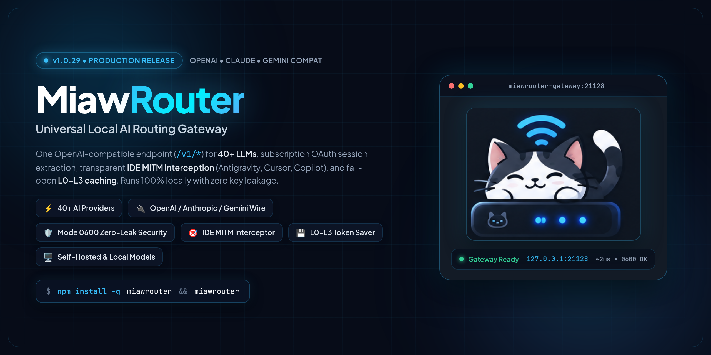

<p align="center">
  
</p>

<p align="center">
  <a href="https://www.npmjs.com/package/miawrouter"></a>
  <a href="https://nodejs.org"></a>
  <a href="LICENSE"></a>
  <a href="SECURITY.md"></a>
  <a href="#mitm-interception"></a>
</p>

<p align="center">
  <a href="README.md">English</a> ·
  <a href="i18n/README.id-ID.md">Bahasa Indonesia</a>
</p>

MiawRouter is a local AI gateway. It runs on your machine, serves one OpenAI-compatible endpoint at `/v1`, and routes each request to a provider driver in `open-sse/providers/registry/`. It rewrites request and response formats between providers, fails over to the next account or model in a combo when one breaks, and serves a dashboard on the same port.

Requests and configured integrations can send data to upstream providers or services. Review the endpoints and privacy settings you enable.

The source tree targets **1.2.5**. The npm badge shows the latest published version, which may differ. See [release audit](docs/release-1.2.5-audit.md) for verification results and outstanding work.

## Contents

- [What it does](#what-it-does)
- [Quick start](#quick-start)
- [First run](#first-run)
- [Dashboard map](#dashboard-map)
- [Connect your CLI or IDE](#connect-your-cli-or-ide)
- [Providers and routing](#providers-and-routing)
- [MITM interception](#mitm-interception)
- [Token saver cache](#token-saver-cache)
- [Security model](#security-model)
- [Configuration](#configuration)
- [Development](#development)
- [Documentation](#documentation)

## What it does

| Capability | How it works |
| --- | --- |
| One endpoint for every tool | `/v1/chat/completions`, `/v1/messages`, `/v1/models`, and the rest of the OpenAI surface. Point any OpenAI-compatible client at it. |
| Provider drivers | Registry definitions cover cloud APIs, subscription OAuth, free tiers, local runtimes, and media providers. Availability depends on the provider and account. |
| Format translation | Translates between OpenAI, Anthropic, Gemini, and provider-specific wire formats, including streaming SSE and Protobuf relays. |
| Fallback combos | Ordered model chains with automatic failover, plus round-robin pools for multi-account setups. |
| MITM interception | Reroutes traffic from Antigravity, Cursor, GitHub Copilot, and Amazon Q without editing their config files. |
| Token saver and cache | Configurable compression and cache layers; effectiveness depends on the request and provider. |
| Local runtimes | Whisper, llama.cpp, vLLM, Kokoro-FastAPI, and any OpenAI-compatible speech, embedding, or chat server you host. |

## Quick start

### Install globally

```bash
npm install -g miawrouter
miawrouter
```

Node.js 20.18.1 or newer is required. The 1.2.5 CLI defaults to loopback and opens `http://127.0.0.1:21128/dashboard`. Data defaults to `~/.miawrouter` on macOS/Linux and `%APPDATA%\miawrouter` on Windows. Set `DATA_DIR` to use another location.

To deliberately permit LAN access, run `miawrouter --host 0.0.0.0` and configure authentication and network access controls. An occupied port is reported instead of terminating the service already using it.

OpenCode Free Bridge is not started automatically. Existing compatible-provider configuration is preserved; use provider-supported access and observe upstream restrictions.

### Run from source

```bash
git clone https://github.com/skutanjir/miawrouter.git
cd miawrouter
cp .env.example .env
npm install
npm run dev
```

The dev server listens on `http://127.0.0.1:21127`. To run the production build:

```bash
npm run build
npm run start
```

`npm run start` listens on `http://127.0.0.1:21128`. The two scripts pin their ports, so `PORT` in `.env` does not move a dev server that was started with `npm run dev`.

### Docker

```bash
docker build -t miawrouter .
docker run -d --name miawrouter \
  -p 21128:21128 \
  -v "$HOME/.miawrouter:/app/data" \
  -e DATA_DIR=/app/data \
  miawrouter
```

Or bring up the bundled compose file, which also starts a Headroom sidecar:

```bash
docker compose up -d
```

## First run

1. Open `http://127.0.0.1:21128` from the same machine. There is no default password, so the first visit over loopback asks you to create one with at least 8 characters.
2. Open **Endpoint**. If no API key exists yet, the page creates one named `Default Key`, so `/v1` works without manual setup. Copy it from the API Keys panel.
3. Open **Providers** and connect what you want to route to. API keys, OAuth subscriptions, and free tiers are all added from here.
4. Point your client at `http://127.0.0.1:21128/v1` with that key.

Dashboard setup routes accept loopback connections only. A remote visitor gets HTTP 403.

## Dashboard map

The dashboard carries about 40 pages. The ones you will open most:

| Page | Purpose |
| --- | --- |
| **Providers** | Connect providers, test them in bulk, manage multiple accounts per provider. |
| **Endpoint** | API endpoint configuration, API key management, tunnel and Tailscale exposure. |
| **Combos** | Model combos with fallback and round-robin strategies, plus the vision and audio capacity adapter. |
| **CLI Tools** | Per-tool configuration for the CLIs and IDEs listed below. |
| **Usage** | The provider topology graph and live route tracing. |
| **Logs** / **Activity** | Request history, per-request token counts, and errors. |
| **Costs** / **Quota** | Spend tracking and provider quota burn. |
| **Token Saver** / **Cache** | Cache hit rates, cache layers, and savings. |
| **MITM** | Certificate authority management and intercepted traffic. |
| **Settings** | Runtime configuration, proxy pools, webhooks, and cloud sync. |

## Connect your CLI or IDE

| Client | Base URL | Key | Notes |
| --- | --- | --- | --- |
| Claude Code | `http://127.0.0.1:21128/v1` | MiawRouter key | Anthropic-format routing |
| Codex CLI | `http://127.0.0.1:21128/v1` | MiawRouter key | Codex reasoning overrides |
| Cursor | `http://127.0.0.1:21128/v1` | MiawRouter key | Or use MITM instead of a base URL |
| Cline / Roo Code | `http://127.0.0.1:21128/v1` | MiawRouter key | OpenAI-compatible |
| OpenCode / Hermes | `http://127.0.0.1:21128/v1` | MiawRouter key | Any registered model or combo |
| Antigravity / Copilot / Amazon Q | not configurable | not applicable | Handled by MITM |

The **CLI Tools** page writes the config for each of these for you.

## Providers and routing

`open-sse/providers/registry/` holds one file per provider, and `open-sse/providers/registry/index.js` imports all of them. Categories:

- **Cloud APIs**: OpenAI, Anthropic, Google Gemini, DeepSeek, xAI, Groq, Mistral, Cohere, Together, Cerebras, SiliconFlow, OpenRouter, and others.
- **Subscription OAuth**: active Claude Code, Codex, GitHub Copilot, and Cursor subscriptions. Tokens refresh in the background.
- **Free tiers**: catalog entries where available. Eligibility, usage limits and availability depend on the provider; OpenCode Free is restricted to its supported client.
- **Media and local**: speech to text, text to speech, embeddings, and self-hosted chat servers.

### Combos

A combo is an ordered list of models. Eligible failures can trigger fallback; invalid or cancelled requests do not. Round-robin rotates model choices; account selection is handled separately. The capacity adapter can add configured alternatives for image or audio requests. Capability metadata may be incomplete, so verify that each selected model supports the input.

### Model naming

Address a model as `provider/model` or address a combo by its ID. `/v1/models` lists models derived from configured connections and available catalogs; an entry does not guarantee live availability or account access.

## MITM interception

`src/mitm/` runs a local TLS interception proxy so desktop tools that hardcode their backend host can still be rerouted. The proxy generates a local root CA on first boot, decrypts the connection, normalizes gRPC, Protobuf, SSE, or JSON, applies your routing, and forwards to the provider you chose.

```
[ Antigravity / Cursor / Copilot / Amazon Q ]
                    │
                    ▼  host redirected to 127.0.0.1
          [ MiawRouter MITM :443 ]
                    │
        ├── decrypt with the local root CA
        ├── normalize the wire format
        ├── apply aliases and combos
        └── forward to the selected provider
```

Intercepted hosts live in `src/mitm/config.js`:

| Target | Hosts |
| --- | --- |
| Google Antigravity | `cloudcode-pa.googleapis.com`, `daily-cloudcode-pa.googleapis.com` |
| Cursor | `api2.cursor.sh`, `agent.api5.cursor.sh`, `agentn.api5.cursor.sh` and their regional variants |
| GitHub Copilot | `api.individual.githubcopilot.com` |
| Amazon Q / Kiro | `q.us-east-1.amazonaws.com`, `codewhisperer.us-east-1.amazonaws.com`, `runtime.us-east-1.kiro.dev` |

### Wire capture

Capture is off by default. Turn it on only while debugging:

```bash
export MITM_CURSOR_CAPTURE=1        # metadata only: method, path, byte counts, header names
export MITM_CURSOR_CAPTURE_FULL=1   # add raw bytes, written to $DATA_DIR/logs/mitm/ at mode 0600
```

Metadata capture never writes headers, cookies, tokens, or body text. Raw capture can contain prompts and tool results, so point it at a sanitized prompt and delete the captures when you are done.

Development request/response dumps additionally require `NODE_ENV=development` and `MITM_DEBUG_CAPTURE=1`. Credential headers and URL queries are masked, but bodies can contain private data. MITM logs are retained across restarts. On Windows, file access is controlled by ACLs rather than Unix mode bits.

## Token saver cache

Four layers in `open-sse/cache/`, all fail-open. A cache failure falls through to the provider instead of failing the request.

| Layer | What it does |
| --- | --- |
| L0 | Keeps request prefixes stable so provider-side prompt caching keeps hitting. |
| L1 | Exact-match LRU for non-streaming, tool-free requests with temperature zero. |
| L2 | Optional embedding similarity for eligible prompts; disabled by default. |
| L3 | Deduplicates repeated conversation blocks and context payloads. |

Eligible response-cache lookups may return `X-Miaw-Cache` and `X-Miaw-Cache-Layer` headers. Bypass response caching with `X-Miaw-Bypass: cache` or specify individual layers such as `cache-l1,cache-l2`. Temperature zero is not a guarantee of deterministic provider output.

## Security model

1. **Loopback by default.** The server binds `127.0.0.1`. Remote requests to dashboard setup routes return 403.
2. **Generated secrets.** `JWT_SECRET`, `API_KEY_SECRET`, and `MACHINE_ID_SALT` are generated on first boot. Unix files use mode `0600`; Windows ACL hardening requires separate review.
3. **Weak secret rejection.** `secret-policy.cjs` refuses placeholder secrets such as documented examples before the listener binds.
4. **Socket-derived client IP.** `custom-server.js` reads the client address from the TCP socket and strips `X-Forwarded-For` unless a trusted loopback proxy set it.
5. **SSRF controls.** Destination validation is used in relevant proxy and webhook paths; local provider endpoints require separate consideration.
6. **Packaging checks.** Build exclusions and package scans reduce accidental inclusion of local data; inspect each release artifact before publishing.

Provider credentials are stored in the local database; protect the database and its backups. Optional request logs and MITM capture bodies may contain sensitive content.

[SECURITY.md](SECURITY.md) has the threat model and the disclosure process.

## Configuration

`.env.example` is the contract; every name below is read by the running code.

| Variable | Default | Meaning |
| --- | --- | --- |
| `DATA_DIR` | platform-specific user data directory | Where the database, secrets, and logs live. |
| `PORT` | `21128` | Listen port for the packaged server. `npm run dev` pins 21127 and `npm run start` pins 21128. |
| `INITIAL_PASSWORD` | unset | Optional first password. The first successful loopback login bcrypt-hashes it into the database. |
| `JWT_SECRET` | generated | Signing key for the dashboard session cookie. |
| `API_KEY_SECRET` | generated | HMAC secret for generated API keys. |
| `MACHINE_ID_SALT` | generated | Salt for stable machine ID hashing. |
| `REQUIRE_API_KEY` | `true` | Gate `/v1` and `/v1beta` behind a valid key. `true` and `false` override the dashboard setting; unset follows it. |
| `BASE_URL` | `http://localhost:21128` | Address this instance uses when it calls its own cloud sync routes. |
| `CLOUD_URL` | `https://miawrouter.web.id` | Cloud sync host. |
| `ENABLE_REQUEST_LOGS` | `false` | Write request logs. |
| `OBSERVABILITY_ENABLED` | `true` | Expose metrics and health signals. |
| `AUTH_COOKIE_SECURE` | `false` | Set the `Secure` flag on the auth cookie when serving over HTTPS. |
| `HTTP_PROXY` / `HTTPS_PROXY` / `ALL_PROXY` / `NO_PROXY` | unset | Outbound proxy for provider calls. Lowercase variants work too. |
| `SEARXNG_URL` | unset | Endpoint for the built-in web search provider. |
| `MITM_CURSOR_CAPTURE` / `MITM_CURSOR_CAPTURE_FULL` | `0` | Wire capture for the Cursor relay. See [MITM interception](#mitm-interception). |
| `MITM_DEBUG_CAPTURE` | unset | Enable raw MITM dumps in development only. |
| `MIAW_MAX_CONCURRENT` / `MIAW_PROVIDER_MAX_CONCURRENT` / `MIAW_CONNECTION_MAX_CONCURRENT` | `256` / `64` / `32` | Concurrent upstream request limits. |
| `MIAW_QUEUE_TIMEOUT_MS` | `120000` | Maximum wait for a concurrency slot. |

## Development

```bash
npm install
npm --prefix tests install
npm run dev        # http://127.0.0.1:21127
```

| Script | Runs |
| --- | --- |
| `npm run dev` | Next.js dev server on port 21127 |
| `npm run dev:webpack` | Same, forced onto webpack |
| `npm run build` | Production build |
| `npm run start` | Production server on port 21128 |
| `npm run lint` | ESLint over the repository |
| `npm test` | Full suite through `scripts/run-tests.mjs` |
| `npm run test:ci` | CI suite, no provider credentials required |
| `npm run ci` | lint plus `test:ci` |
| `npm run bench` | Benchmark harness in `bench/` |
| `npm run bench:record` / `npm run bench:verify` | Record or verify a benchmark baseline |
| `npm run cli:pack` / `npm run cli:publish` | Package or publish the CLI in `cli/` |

Tests live in `tests/`, split into `unit/`, `translator/`, and a characterization baseline in `__baseline__/`. The CI suite runs without real provider credentials, so you can reproduce a green pipeline locally with `npm run ci`.

The branding gate is part of the repository contract:

```bash
node scripts/check-branding.mjs
```

Run it before opening a pull request. Required third-party license notices must be preserved.

## Documentation

- [SECURITY.md](SECURITY.md): threat model and vulnerability disclosure.
- [DOCKER.md](DOCKER.md): container deployment detail.
- [CONTRIBUTING.md](CONTRIBUTING.md): development workflow and how to add a provider.
- [CHANGELOG.md](CHANGELOG.md): release notes.
- [1.2.5 audit](docs/release-1.2.5-audit.md): tested behavior and remaining release work.

## Contributing

Bug reports, provider integrations, and documentation fixes are welcome. Read [CONTRIBUTING.md](CONTRIBUTING.md) first, then run `npm run ci` and `node scripts/check-branding.mjs` before you open a pull request.

## License

[MIT](LICENSE).

Third-party license notices are included in [cli/THIRD_PARTY_NOTICES.md](cli/THIRD_PARTY_NOTICES.md).
